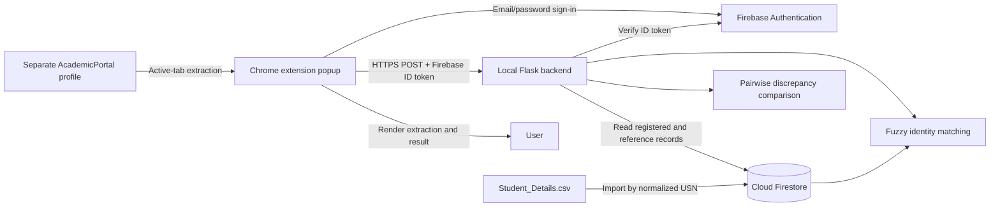

# DETECTION OF DATA DISCREPANCY AND STORAGE OF STUDENT DETAILS FOR ACADEMIC CONSISTENCY

This major project combines a Flask application, Firebase services, a Chrome extension, and a record-comparison engine. The extension reads selected fields from a student profile on the separate AcademicPortal application and sends them to the local Flask backend for comparison.

> **For local development:** This guide assumes Windows 10 or Windows 11, PowerShell, and a Firebase project for which you have been authorized. The Flask development server is configured for local use; it is not a production deployment guide.

## Table of contents

1. [Project overview](#1-project-overview)
2. [System architecture](#2-system-architecture)
3. [Prerequisites](#3-prerequisites)
4. [Obtain the project](#4-obtain-the-project)
5. [Backend setup](#5-backend-setup)
6. [Firebase configuration](#6-firebase-configuration)
7. [Local HTTPS configuration](#7-local-https-configuration)
8. [Reference dataset setup](#8-reference-dataset-setup)
9. [Chrome extension setup](#9-chrome-extension-setup)
10. [Run the complete application](#10-run-the-complete-application)
11. [Testing discrepancy detection](#11-testing-discrepancy-detection)
12. [Troubleshooting](#12-troubleshooting)
13. [Security guidelines](#13-security-guidelines)
14. [Developer collaboration](#14-developer-collaboration)
15. [Limitations and future improvements](#15-limitations-and-future-improvements)

## 1. Project overview

### Problem statement

Student details can differ between a student's registered account, an academic reference dataset, and information displayed by an external academic portal. Comparing those records manually can make mismatches difficult to find and identity mistakes difficult to spot.

### Objectives

- Store a student's account and academic record in Cloud Firestore.
- Authenticate users with Firebase Authentication.
- Verify Firebase identity on the Flask backend before returning account-specific results.
- Compare externally displayed academic details with registered and reference records.
- Treat uncertain or ambiguous identity matches cautiously rather than claiming a confirmed match.

### Main features

- Email/password account registration and sign-in.
- Firebase ID-token verification and a Flask filesystem session for the website flow.
- Student record storage in Firestore under the authenticated Firebase UID.
- A Chrome popup that extracts selected fields from a supported AcademicPortal profile.
- Authenticated HTTPS requests from the extension to the local Flask comparison endpoint.
- Exact USN lookup, bounded reference lookup, fuzzy candidate matching, and pairwise discrepancy summaries.
- A CSV importer for the synthetic reference-student dataset.

### Technologies

| Area | Technology |
|---|---|
| Backend | Python, Flask, Flask-Session |
| Identity and database | Firebase Authentication, Firebase Admin SDK, Cloud Firestore |
| Matching and comparison | Python, RapidFuzz, custom normalization and comparison logic |
| Browser extension | Chrome Manifest V3, JavaScript, Firebase Web SDK |
| Extension build | Node.js, npm, esbuild |
| Local HTTPS | mkcert and the Flask development server |
| Tests | Python `unittest` |

## 2. System architecture

AcademicPortal is a **separate application**. It is not included in this repository. The extension accepts the HTTPS student-profile URL format `https://vishnu05.pythonanywhere.com/students/<USN>`. Its path check also permits one optional trailing slash. It reads page elements identified by `data-field` attributes.



The extension only extracts page fields after its popup is opened. The user signs in with Firebase in the popup and starts comparison with **Compare Student Records**. The popup sends the extracted record and a short-lived Firebase ID token to `POST /api/extension/compare` over HTTPS. Flask verifies the token, selects the appropriate comparison mode, reads only the records needed for that mode, and returns a JSON result.

The backend uses these Firestore collections:

- `users/{uid}` — basic profile information associated with a Firebase account.
- `student_records/{uid}` — the authenticated user's submitted academic record.
- `reference_students/{UPPERCASE_USN}` — imported reference records, with document IDs derived from trimmed, uppercase USNs.

The web application uses `/` for the login page and `/signup` for registration. After Firebase sign-up or sign-in, the browser sends an ID token to `POST /greettree`; Flask verifies it and establishes a session. The authenticated student form is at `/session_page`, and `POST /greetsession` saves submitted details. `/greet` displays the saved record, and `/api/my-details` returns the signed-in user's projected details. The extension comparison endpoint is `POST /api/extension/compare`.

## 3. Prerequisites

Install software only from the official links below. Open a **new PowerShell window** after an installer changes PATH so the new command locations are loaded.

### Windows 10 or 11

Check the operating system:

```powershell
Get-CimInstance Win32_OperatingSystem | Select-Object Caption, Version, BuildNumber
```

The `Caption` should identify Windows 10 or Windows 11. Windows 10/11 is the environment covered by this guide.

### Python and pip

Python 3.13 (64-bit) is a suitable version for this project. The repository does not pin a Python version, so use the same major/minor version as the team where possible.

Check the Python launcher and pip:

```powershell
py -3.13 --version
py -3.13 -m pip --version
```

The first command should print `Python 3.13...`; the second should identify pip installed for that Python. If `py` is not recognized or Python 3.13 is missing, install a Windows release from [Python.org](https://www.python.org/downloads/windows/). In the installer, enable the option to add Python to PATH (if offered). Reopen PowerShell and run the checks again. If pip is missing after Python is installed, run:

```powershell
py -3.13 -m ensurepip --upgrade
py -3.13 -m pip --version
```

If the `py` launcher is not available but `python` is, use `python --version` and `python -m pip --version` instead.

### Git

Check Git and confirm PowerShell can find it:

```powershell
git --version
Get-Command git
```

The first command should print a Git version and the second should show the executable location. If either command is unavailable, install Git from [git-scm.com](https://git-scm.com/download/win). Keep the installer option that makes Git available from the command line. Reopen PowerShell and repeat the checks.

### Node.js and npm

Check both commands:

```powershell
node --version
npm --version
```

Both should print version numbers. If either is unavailable, install the current **LTS** Windows installer from [nodejs.org](https://nodejs.org/en/download). npm is included with Node.js. Keep the installer option that adds Node.js to PATH, reopen PowerShell, and verify both commands again.

### Google Chrome

Check common per-machine and per-user installation locations:

```powershell
$chromeCandidates = @(
    "$env:ProgramFiles\Google\Chrome\Application\chrome.exe",
    "${env:ProgramFiles(x86)}\Google\Chrome\Application\chrome.exe",
    "$env:LOCALAPPDATA\Google\Chrome\Application\chrome.exe"
)
$chromePath = $chromeCandidates | Where-Object { Test-Path $_ } | Select-Object -First 1
if ($chromePath) { & $chromePath --version } else { 'Chrome was not found in the standard install locations.' }
```

If Chrome is not found, install it from [Google's Chrome download page](https://www.google.com/chrome/download-chrome/), then rerun the check. Chrome must be available to load and use the Manifest V3 extension.

### mkcert

Check whether mkcert is on PATH:

```powershell
Get-Command mkcert -ErrorAction SilentlyContinue
mkcert -version
```

If the command is not found, use the Windows installation guidance or a Windows executable from the [official mkcert project](https://github.com/FiloSottile/mkcert#installation) and [releases](https://github.com/FiloSottile/mkcert/releases). For a downloaded executable, place it in a user-owned tools folder such as `$env:LOCALAPPDATA\Programs\mkcert`, name it `mkcert.exe`, add that folder to your **user** PATH in Windows Environment Variables, and reopen PowerShell. Then rerun `Get-Command mkcert` and `mkcert -version`.

### Firebase project access

Open the [Firebase console](https://console.firebase.google.com/) and confirm an authorized project administrator has granted you access to the project's Authentication, Firestore, and service-account configuration. If not, ask the project administrator; do not use another person's credentials.

### Internet access

Internet access is needed to install Python/npm dependencies and to use Firebase Authentication and Cloud Firestore. Check registry connectivity with:

```powershell
Test-NetConnection pypi.org -Port 443
Test-NetConnection registry.npmjs.org -Port 443
```

Look for `TcpTestSucceeded : True`. A corporate firewall or proxy may require administrator configuration if either connection fails.

## 4. Obtain the project

The GitHub repository is private. Ask **Shiras**, the repository owner, to invite your GitHub account as a collaborator. Accept the invitation and configure GitHub authentication using Git Credential Manager or your own SSH key. A clone URL does not grant access by itself; never put a password or token in the URL.

After access is granted, clone the existing repository:

```powershell
git clone https://github.com/shiraschandra220705/DETECTION-OF-DATA-DISCREPANCY-AND-STORAGE-OF-STUDENT-DETAILS-FOR-ACADEMIC-CONSISTENCY.git
Set-Location DETECTION-OF-DATA-DISCREPANCY-AND-STORAGE-OF-STUDENT-DETAILS-FOR-ACADEMIC-CONSISTENCY
```

If GitHub prompts for authentication, complete the browser/Git Credential Manager flow. Do not paste a personal access token into a command or commit it to the repository.

Verify the clone:

```powershell
Test-Path .\projectwork\app.py
Test-Path .\student-discrepancy-extension\manifest.json
git remote -v
git status --short
```

The first two commands should return `True`. `git remote -v` should show the existing GitHub repository, and `git status --short` should be empty on a clean clone.

## 5. Backend setup

Run these commands from the repository root.

1. Create a virtual environment using Python 3.13:

   ```powershell
   py -3.13 -m venv .venv
   ```

2. Activate it in PowerShell:

   ```powershell
   .\.venv\Scripts\Activate.ps1
   ```

   The prompt should show `(.venv)`. If PowerShell blocks activation, allow scripts only for the current PowerShell process, then retry:

   ```powershell
   Set-ExecutionPolicy -Scope Process -ExecutionPolicy RemoteSigned
   .\.venv\Scripts\Activate.ps1
   ```

   This does not change the machine-wide execution policy. If a managed-device policy still blocks it, use Command Prompt with `.venv\Scripts\activate.bat`, or run the virtual environment's Python directly as `.\.venv\Scripts\python.exe`.

3. Confirm Python and pip refer to the virtual environment:

   ```powershell
   python --version
   python -m pip --version
   ```

   The pip path should be under this repository's `.venv` directory.

4. Install backend dependencies and check them:

   ```powershell
   python -m pip install --upgrade pip
   python -m pip install -r requirements.txt
   python -m pip check
   ```

   `pip check` should report no broken requirements. The current `requirements.txt` lists Flask, Flask-Session, Firebase Admin, RapidFuzz, and python-dotenv without pinned versions; a Python lockfile is not included.

The Flask module requires `FLASK_SECRET_KEY` to be set before it is imported. Firebase Admin also needs Application Default Credentials for the intended Firebase project. Configure those in the same PowerShell session used to start Flask (see [Firebase configuration](#6-firebase-configuration)).

## 6. Firebase configuration

### Project-side setup

Ask an authorized Firebase project administrator to:

1. Confirm you have access to the same Firebase project referenced by the app's client configuration.
2. In **Authentication → Sign-in method**, enable **Email/Password** if it is not already enabled. Both the website and extension use email/password sign-in.
3. Create/confirm the Cloud Firestore database. The backend uses `users`, `student_records`, and `reference_students` collections.
4. Provide or authorize a Firebase Admin service-account credential for local backend development and grant it the least privileges needed to verify Firebase identities and read/write the project records.

Firebase's [password authentication guide](https://firebase.google.com/docs/auth/web/password-auth), [Firestore quickstart](https://firebase.google.com/docs/firestore/quickstart), and [Admin SDK setup guide](https://firebase.google.com/docs/admin/setup) document these project-side steps.

The backend initializes `firebase_admin` using Application Default Credentials and creates its Firestore client at startup. Admin SDK access is authorized by Google Cloud IAM credentials; Firestore Security Rules do not restrict these trusted server-side Admin SDK calls. Do not make client-facing rules broadly readable or writable as a workaround for backend IAM errors.

### Firebase Web configuration versus Admin credentials

The repository has client-side Firebase Web configuration in:

- `projectwork/static/firebase-config.js`
- `student-discrepancy-extension/scripts/firebase-config.js`

These files contain Web SDK configuration used to connect the client to Firebase Authentication (and initialize the Web SDK). Web configuration is intended to be present in client code; the `apiKey` field is not a Firebase Admin private key. Restrict the API key to the intended APIs where applicable. If the team uses a different Firebase project, ask an administrator for that project's Web configuration.

The Firebase Admin service-account JSON is different: it contains a private key and must remain outside the repository. Never paste it into a Web config file.

### Keep all Firebase project IDs consistent

The Firebase Web configuration in **both** `projectwork/static/firebase-config.js` and `student-discrepancy-extension/scripts/firebase-config.js`, the Firebase project associated with the Admin service-account credentials used by Flask, and the Firestore database containing `reference_students` must all belong to the **same Firebase project**. Ask the administrator to confirm the project ID for all of them before testing.

If the extension signs in to project A while Flask verifies tokens with project B, token verification can fail. If the CSV is imported into one project's Firestore while Flask reads another project's Firestore, reference lookups can report that no reference record is available even though the import succeeded elsewhere.

### Store Admin credentials outside the repository

Create a user-local credential folder and place the authorized JSON file there using a secure transfer method:

```powershell
$credentialDir = Join-Path $env:USERPROFILE 'firebase-credentials'
New-Item -ItemType Directory -Force -Path $credentialDir | Out-Null
```

For example, if the administrator supplied `serviceAccountKey.json`, configure the current PowerShell session:

```powershell
$env:GOOGLE_APPLICATION_CREDENTIALS = Join-Path $credentialDir 'serviceAccountKey.json'
if (-not (Test-Path $env:GOOGLE_APPLICATION_CREDENTIALS)) { throw 'Admin credential file was not found.' }
```

The check prints no credential contents. Confirm with the administrator that the JSON belongs to the intended Firebase project and that its service account has the needed access. Keep the file out of the clone and do not email, commit, or upload it to a public location.

### Set the Flask secret

Generate a unique secret for this local development session without printing it to the terminal:

```powershell
$env:FLASK_SECRET_KEY = (& python -c "import secrets; print(secrets.token_hex(32))").Trim()
if ([string]::IsNullOrWhiteSpace($env:FLASK_SECRET_KEY)) { throw 'FLASK_SECRET_KEY was not set.' }
$env:FLASK_REQUIRE_HTTPS = 'true'
```

`FLASK_SECRET_KEY` is required by `projectwork/app.py`. `FLASK_REQUIRE_HTTPS` is optional in the code and defaults to `true`; setting it explicitly documents the intended extension behavior. These variables apply only to the current PowerShell process. Recreate them in a new terminal. The app does not require a `FIREBASE_CONFIG` or `FLASK_APP` variable for the commands in this guide.

## 7. Local HTTPS configuration

The extension's comparison endpoint is `https://127.0.0.1:5000/api/extension/compare`. The backend rejects non-HTTPS extension requests by default, and Chrome must trust the certificate for the HTTPS request to succeed.

Each laptop must create and trust its **own** local certificate. Do not share certificate private keys or mkcert's local CA private key.

1. Create a directory outside the repository and install mkcert's local CA in the Windows trust store:

   ```powershell
   $certDir = Join-Path $env:LOCALAPPDATA 'MajorProject\certs'
   New-Item -ItemType Directory -Force -Path $certDir | Out-Null
   mkcert -install
   ```

2. Generate a certificate with both names the project needs:

   ```powershell
   mkcert `
     -cert-file (Join-Path $certDir 'localhost-127.0.0.1.pem') `
     -key-file (Join-Path $certDir 'localhost-127.0.0.1-key.pem') `
     localhost 127.0.0.1
   ```

   Confirm the files exist without opening or printing them:

   ```powershell
   Test-Path (Join-Path $certDir 'localhost-127.0.0.1.pem')
   Test-Path (Join-Path $certDir 'localhost-127.0.0.1-key.pem')
   mkcert -CAROOT
   ```

   The first two commands should return `True`. `mkcert -CAROOT` prints the local CA directory; keep that CA's private key on this laptop only. The root `.gitignore` excludes common local certificate/key extensions as an extra safeguard.

3. After Flask is running with these certificate paths, open `https://127.0.0.1:5000/` in Chrome. It should load without a certificate warning. If the CA was just installed, fully restart Chrome and try again.

The `--cert` and `--key` options are passed directly to Flask's development server; the application has no certificate-path environment variables.

## 8. Reference dataset setup

`projectwork/data/Student_Details.csv` contains 50 synthetic records for local/project testing. It is imported into the Firestore `reference_students` collection by `projectwork/import_reference_data.py`. The importer does not print record contents.

With the virtual environment active and `GOOGLE_APPLICATION_CREDENTIALS` set, run from the repository root:

```powershell
python -m projectwork.import_reference_data
```

The importer reads the CSV relative to its own script location, requires a `USN` column, converts each nonblank USN to uppercase for its Firestore document ID, and writes every CSV column to that document. It skips blank USNs and repeated USNs after the first occurrence. It uses `batch.set` with stable document IDs, so rerunning with the same rows updates/replaces those same documents rather than creating duplicate documents.

The importer **does not delete stale Firestore documents** when a row is removed or its USN changes in the CSV. Ask the Firebase administrator to review and remove obsolete `reference_students` documents if the dataset is intentionally changed. The importer only writes to `reference_students`; it does not overwrite `users` or `student_records`.

The service account needs permission to write the reference collection. If the command reports an import failure, it intentionally avoids printing detailed Firestore exception text; ask an administrator to check the credential project and its IAM permissions.

## 9. Chrome extension setup

Open PowerShell at the repository root and verify Node/npm as described in [Prerequisites](#3-prerequisites). Then install from the committed lockfile and build:

```powershell
Set-Location .\student-discrepancy-extension
npm ci
npm run build
Test-Path .\dist\popup.js
```

`npm ci` installs the exact dependency tree recorded in `package-lock.json`; `npm run build` bundles the popup and Firebase imports into `dist/popup.js`. The final check should return `True`.

Load the extension in Chrome:

1. Open `chrome://extensions` in the address bar.
2. Turn on **Developer mode**.
3. Select **Load unpacked**.
4. Choose the repository's `student-discrepancy-extension` directory (the directory containing `manifest.json`).
5. Pin the extension from Chrome's Extensions menu if you want it on the toolbar.

After changing source files, run `npm run build` again and select **Reload** on the extension's card. `node_modules/` and `dist/` are generated locally and are excluded by the extension `.gitignore`; do not commit them. The supported Chrome steps are also described in [Chrome's official unpacked-extension guide](https://developer.chrome.com/docs/extensions/get-started/tutorial/hello-world).

## 10. Run the complete application

Use two PowerShell windows. Keep the backend window open while using the extension.

### Start Flask over HTTPS

In the first window, from the repository root:

```powershell
Set-Location 'C:\path\to\your\clone'
.\.venv\Scripts\Activate.ps1
$credentialDir = Join-Path $env:USERPROFILE 'firebase-credentials'
$env:GOOGLE_APPLICATION_CREDENTIALS = Join-Path $credentialDir 'serviceAccountKey.json'
$env:FLASK_SECRET_KEY = (& python -c "import secrets; print(secrets.token_hex(32))").Trim()
$env:FLASK_REQUIRE_HTTPS = 'true'
$certDir = Join-Path $env:LOCALAPPDATA 'MajorProject\certs'
python -m flask --app projectwork.app run --host 127.0.0.1 --port 5000 --cert (Join-Path $certDir 'localhost-127.0.0.1.pem') --key (Join-Path $certDir 'localhost-127.0.0.1-key.pem')
```

Replace `<path-to-your-clone>` with the directory created by `git clone`. If your Admin JSON has a different file name, set `GOOGLE_APPLICATION_CREDENTIALS` to that authorized file's path. The Flask terminal should remain running and show that the development server is listening on port 5000.

In another PowerShell window, verify the login page responds and Windows trusts the certificate:

```powershell
(Invoke-WebRequest -Uri 'https://127.0.0.1:5000/').StatusCode
```

Expected result: `200`. Open the same URL in Chrome and confirm there is no certificate warning.

### Use the Chrome extension

1. If you do not already have an account, open `https://127.0.0.1:5000/signup` and register with the project's enabled email/password provider. Complete the student details form so the backend can save the account's record.
2. Confirm the separate AcademicPortal site is reachable and open a student profile at `https://vishnu05.pythonanywhere.com/students/<USN>`. The implementation also permits the same path with one trailing slash.
3. Open the Student Data Discrepancy Detector extension popup. It attempts extraction when opened; you can also select **Extract Student Details**.
4. Sign in with the Firebase email/password account authorized for the project. The popup uses Firebase Authentication and keeps its signed-in state with browser extension storage.
5. Review the extracted fields. Select **Compare Student Records** to send the record to the local HTTPS backend.
6. Review the comparison mode, identity status, field matches/mismatches/missing values, and overall result.

The backend window must remain running for comparison. The extension currently accepts only the configured AcademicPortal host and student profile path. It looks for page elements with `data-field` values such as `usn`, `name`, `dob`, `college`, `branch`, `semester`, `academic_year`, `cgpa`, `tenth_percentage`, and `twelfth_percentage`.

## 11. Testing discrepancy detection

Run the backend's offline Python test suite from the repository root with the virtual environment active:

```powershell
python -m unittest discover -s projectwork/tests -v
```

The suite uses Python's built-in `unittest` runner and covers model normalization, fuzzy matching, pairwise comparisons, Flask request validation, token verification behavior, and safe reference lookup. These tests use mocks/test clients; they do not replace setup of a real Firebase project or end-to-end Chrome/AcademicPortal testing.

The backend tests cover these representative outcomes:

1. **Registered student with mismatched external details.** If the authenticated user's normalized USN matches the extracted USN, the backend uses `personal` mode. It compares the registered record, reference record, and external record where available. A mismatch in compared fields produces a discrepancy result; an example is covered by `test_successful_three_way_comparison_with_discrepancy`.
2. **Reference student is not the authenticated student.** If the extracted USN differs from the signed-in account's USN and exists in the reference collection, the backend uses `other_student` mode and returns only the external-versus-reference comparison. It does not read the other student's private `student_records` document. This is covered by `test_other_student_exact_reference_returns_only_external_comparison`.
3. **Student absent from both registered and reference records.** With no registered record for the signed-in account and no exact reference record for the extracted USN, the backend uses `reference_only` mode, reports that the reference is unavailable, and performs no comparison. It does not claim a match or expose candidate records. This is covered by `test_reference_only_missing_reference_is_clear_and_private_safe`.

Field comparisons use USN, name, DOB, CGPA, semester, 10th and 12th percentages, college, and branch. Values are normalized for common differences such as USN punctuation/case, date formats, numeric strings, and branch aliases. Missing or invalid values are reported separately rather than silently treated as matches.

The matching model uses exact normalized USN first. Its fuzzy path has score and ambiguity thresholds plus independent identity-evidence requirements; an uncertain or ambiguous result must not be treated as a verified identity.

## 12. Troubleshooting

| Problem | What to check |
|---|---|
| `python` or `py` is not recognized | Reinstall Python from Python.org, enable PATH integration if offered, reopen PowerShell, then run `py -3.13 --version`. |
| pip is missing or installs into the wrong Python | Activate `.venv`, then use `python -m pip --version`; bootstrap pip with `py -3.13 -m ensurepip --upgrade` if needed. Avoid a bare `pip` command when multiple Python versions are installed. |
| Virtual environment activation is blocked | Use the process-scoped `Set-ExecutionPolicy -Scope Process -ExecutionPolicy RemoteSigned` command above, Command Prompt activation, or `.\.venv\Scripts\python.exe` directly. Do not change machine-wide policy to work around a managed restriction. |
| Flask exits with `FLASK_SECRET_KEY environment variable is not set` | Set `$env:FLASK_SECRET_KEY` in the same PowerShell window before the Flask command. |
| Flask/Firebase Admin cannot find credentials | Check that `$env:GOOGLE_APPLICATION_CREDENTIALS` points to an existing Admin JSON outside the repository and that it belongs to the intended project. Do not print or paste its contents. |
| Firestore returns permission errors | Ask the project administrator to verify the service account's project and least-privilege IAM access. Admin SDK access is controlled by IAM, not client Firestore rules. |
| `mkcert` is not recognized | Add the folder containing `mkcert.exe` to the user PATH and open a new PowerShell window. Check with `Get-Command mkcert` and `mkcert -version`. |
| Chrome shows a certificate warning | Run `mkcert -install`, generate a certificate including both `localhost` and `127.0.0.1`, verify Flask uses those exact files, then fully restart Chrome. Do not disable certificate checking. |
| HTTPS request is refused or Flask returns an HTTPS-required response | Confirm Flask is running on `127.0.0.1:5000` with the `--cert` and `--key` arguments, and that `FLASK_REQUIRE_HTTPS` is `true`. Keep the backend terminal open. |
| `npm ci` fails | Check internet/DNS access to `registry.npmjs.org`, Node/npm versions, and that `package.json` and `package-lock.json` came from the same repository revision. Do not use `--force` or `--legacy-peer-deps`; share the exact error with the maintainers. |
| Extension does not load or popup bundle is missing | From the extension directory, run `npm ci` then `npm run build`; check for `dist\popup.js`, and select **Reload** in `chrome://extensions`. |
| Firebase sign-in fails | Confirm Email/Password is enabled, the Web config points to the authorized Firebase project, and the account exists or registration is allowed. Never send an ID token to a teammate for debugging. |
| Backend connection fails from the extension | Confirm Flask is running, the endpoint is `https://127.0.0.1:5000`, Chrome trusts the mkcert certificate, and the popup was reloaded after the build. |
| The extension says it is not on AcademicPortal or extracts no fields | Use `https://vishnu05.pythonanywhere.com/students/<USN>` (an optional final slash is accepted), not the homepage. The profile DOM must expose the expected `data-field` attributes; the AcademicPortal application is maintained separately. |
| Reference record is unavailable | Confirm the dataset import completed in the intended Firebase project, the extracted USN is valid, and the normalized USN is present in `reference_students`. Blank and duplicate USNs are skipped by the importer. |

## 13. Security guidelines

- Never commit `.env`, `.env.*`, service-account JSON, Firebase Admin credentials, certificates, private keys, or Flask secrets.
- Never share Firebase ID tokens. The extension obtains a token from the signed-in Firebase user and sends it only to the configured HTTPS comparison endpoint.
- Keep generated Flask session files, Python caches, `node_modules/`, and `dist/` out of Git. The root and extension `.gitignore` files cover these generated artifacts.
- Firebase Web configuration is client-side configuration; it is not a replacement for or container for Admin credentials. Restrict its API key and secure Firestore access appropriately.
- Use the smallest Firebase IAM permissions practical for the local Admin service account. Keep the GitHub repository private and grant access only to approved collaborators.
- Use a unique `FLASK_SECRET_KEY` per developer machine. The current filesystem session and `SESSION_COOKIE_SECURE = False` settings are for local development, not a production deployment.
- Each developer must generate local mkcert certificates and keys. Never commit or share the mkcert CA private key.
- **Outstanding npm audit finding:** the current npm dependency tree includes transitive `@grpc/grpc-js@1.9.16` through Firebase Firestore. The audit reported four high-severity package findings associated with that dependency chain and a separate low-severity advisory for the same package. The vulnerability remains unresolved. The vulnerable package is not included in the current browser bundle; these audit results do not mean it is bundled with the extension. Recheck `npm audit` and track an upstream-compatible remediation; do not describe the finding as fixed or bypass it with `npm audit fix --force`.

## 14. Developer collaboration

The team uses the existing private GitHub repository; do not create a replacement repository. Ask Shiras to grant access before cloning. Before each task, identify the remote branches and confirm with Shiras which branch is the agreed integration branch. The branch name is a team decision; do not assume a name from the repository's branch list.

A branch-independent feature-branch workflow is:

```powershell
git status --short
git fetch origin
git branch --remotes
$integrationBranch = Read-Host 'Enter the integration branch confirmed with Shiras'
$localBranch = git branch --list $integrationBranch
if ($localBranch) {
    git switch $integrationBranch
} else {
    git switch --track "origin/$integrationBranch"
}
git pull --ff-only origin $integrationBranch
$featureBranch = 'feature/short-description'
git switch -c $featureBranch
```

`git branch --remotes` lists remote branch names but does not identify the integration branch; confirm the choice with Shiras. Enter its short name (without the `origin/` prefix) when prompted. Replace `feature/short-description` with a concise branch name. Make and review your changes, then stage only intended files:

```powershell
git status --short
git diff
git add <files-you-intend-to-include>
git diff --cached
git commit -m "Describe the change"
git push -u origin $featureBranch
```

Open a pull request on GitHub against the integration branch confirmed with Shiras and request review. If the confirmed branch is not available locally/remotely or you do not have permission to use it, ask the maintainer before proceeding. Do not commit `.venv/`, `.env`, Admin credentials, local certificates/keys, Flask session data, Python bytecode, `node_modules/`, or `dist/`.

## 15. Limitations and future improvements

### Current limitations

- AcademicPortal is a separate application and its source is not in this repository. The extension is tied to one hostname, the `/students/<USN>` URL shape, and specific `data-field` selectors. Portal changes can break extraction.
- The extension talks to a local loopback HTTPS backend. It is not configured as a hosted production service.
- The reference lookup is bounded to 100 candidate documents when checking uniqueness. An incomplete or ambiguous lookup fails closed instead of claiming a match.
- Fuzzy matching is only a candidate-resolution aid. It has thresholds and identity-evidence gates; the result can be uncertain or ambiguous.
- `requirements.txt` does not pin Python package versions. The npm extension dependency tree is locked, but has the outstanding audit finding described above.
- Re-importing the same CSV overwrites matching reference document IDs but does not remove records that are no longer represented in the CSV.

### Possible future work

- Coordinate an extraction contract with the AcademicPortal maintainers so profile selectors can be tested when that separate application changes.
- Add a documented deployment configuration that uses production-grade HTTPS, secure cookies, and managed credentials rather than local Flask/mkcert settings.
- Pin and periodically review Python dependencies, and resolve the Firebase Firestore transitive gRPC advisory when an upstream-compatible fix is available.
- Add a controlled process for reconciling or removing stale reference documents when the synthetic dataset changes.
